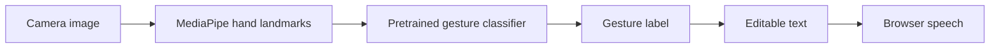
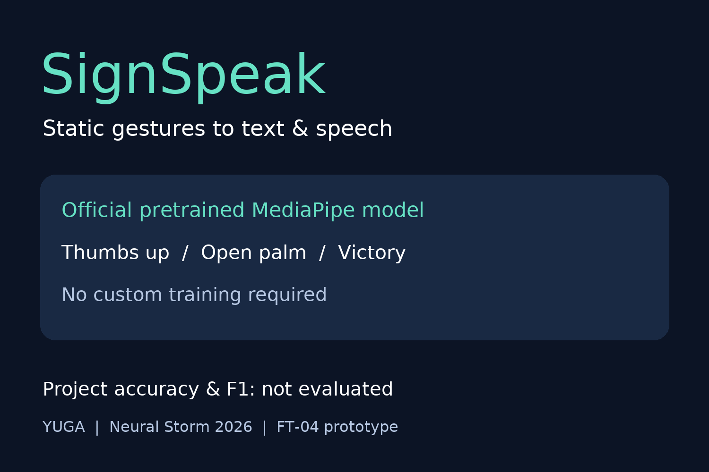

# SignSpeak — FT-04: Sign Language to Text/Speech Translator

Neural Storm 2026 · Future Tech. **Submission scope: a pretrained static gesture-to-text/speech demonstration, not full sign-language translation.**

## Team name and members

**YUGA** — Yugraj Mangate and Gayatri Karanjkar.

## Problem

FT-04 addresses communication barriers involving sign language. Complete translation needs language-specific vocabulary, motion, facial expression and grammar. We demonstrate only a small gesture-label-to-speech interface.

## Solution

The app uses the official pretrained MediaPipe Gesture Recognizer model, bundled in `models/gesture_recognizer.task`. No session recording or custom training is needed for this demo. We did not train the pretrained model or evaluate recognition accuracy on our own dataset.

Supported model labels: Closed_Fist, Open_Palm, Pointing_Up, Thumb_Down, Thumb_Up, Victory, ILoveYou. These are gesture names, not alphabet predictions. Open_Palm is displayed as “Open Palm”, not translated to “HELLO”. ILoveYou is displayed as “I love you”.

## Pipeline



The Streamlit app processes individual snapshots. Desktop inference adds a majority vote and stability timer. Unrecognized or low-confidence poses produce no token.

## Tech stack

Python 3.11, MediaPipe Tasks, OpenCV, NumPy, Streamlit and browser Web Speech API. Desktop speech uses pyttsx3. The optional custom-training scripts use pandas, scikit-learn, joblib and matplotlib; those scripts are not required for the pretrained demo.

## Setup

```bash
python3.11 -m venv .venv
source .venv/bin/activate
python -m pip install -r requirements.txt
streamlit run app.py
```

For desktop webcam windows and speech:

```bash
python -m pip install -r requirements-local.txt
python -m pip install --force-reinstall --no-deps opencv-python==4.10.0.84
python infer.py
```

## Run locally

Take a camera photo while holding a supported pose. Read the predicted gesture and confidence, edit the sentence if desired, and click **Speak sentence**. Camera permission and browser speech support are required. Confidence is uncalibrated and is not accuracy.

For the local webcam script, ENTER speaks, C clears, Q quits. Remove your hand before repeating a token. Without a custom model.joblib, infer.py uses the bundled pretrained model automatically.

Optional custom-data workflow, separate from the submission demo:

```bash
python collect.py
python collect.py
python check_data.py
python train.py --signers 1
```

Do not claim this optional training workflow was completed unless you actually collect and evaluate data. Streamlit currently uses the pretrained bundle explicitly.

## Streamlit Community Cloud deployment

- Repository: yugrajmangate-dev/SignSpeak
- Branch: main
- Main file: app.py
- Advanced settings → Python version: **3.11**

The pinned MediaPipe cannot install on Python 3.14. Changing an existing deployment's Python version requires deleting that Cloud deployment and recreating it with Python 3.11; the GitHub repository remains intact. config.toml sets headless mode, not the Cloud Python interpreter. Cloud requirements exclude desktop audio and keyboard packages; packages.txt supplies Linux libraries required by MediaPipe's contrib OpenCV dependency. No API keys are needed.

## Screenshots



Real camera/demo screenshots remain to be captured. No confusion matrix is included because no project evaluation dataset exists.

## Metrics

| Field | Status |
| --- | --- |
| Accuracy | Not measured |
| Macro F1 | Not measured |
| Latency | Not measured |
| Evaluation samples | Not measured |
| Test session | Not measured |
| Evaluation signers | Not measured |

`results/metrics.json` records data_source=pretrained, supported labels, the official model URL, file size and SHA-256. Evaluation fields are null. No held-out session or cross-signer evaluation has been performed. A model loading/sample inference check is not a recognition benchmark. We do not copy upstream benchmark scores into project results.

## Limitations and responsible use

Only supported static single-hand gestures are recognized. The upstream model card excludes full sign-language translation. The model does not recognize the requested alphabet vocabulary, motion, facial expression or grammar. No project-specific signer evaluation exists. It is not a replacement for human interpreters and should not be used for critical communication.

Snapshots are sent to the Streamlit server for in-memory processing and are not saved by the app. Optional collection saves landmarks and labels only, not images. Screenshots/video are separate user-created artifacts.

## AI tools used

AI tools used: Codex, Claude. They assisted implementation and planning. Pretrained weights are attributed to Google MediaPipe, not team YUGA.

## Model attribution

[Official model documentation](https://developers.google.com/edge/mediapipe/solutions/vision/gesture_recognizer) · [Model card](https://storage.googleapis.com/mediapipe-assets/gesture_recognizer/model_card_hand_gesture_classification_with_faireness_2022.pdf). See models/README.md and the included upstream license for source and provenance.
